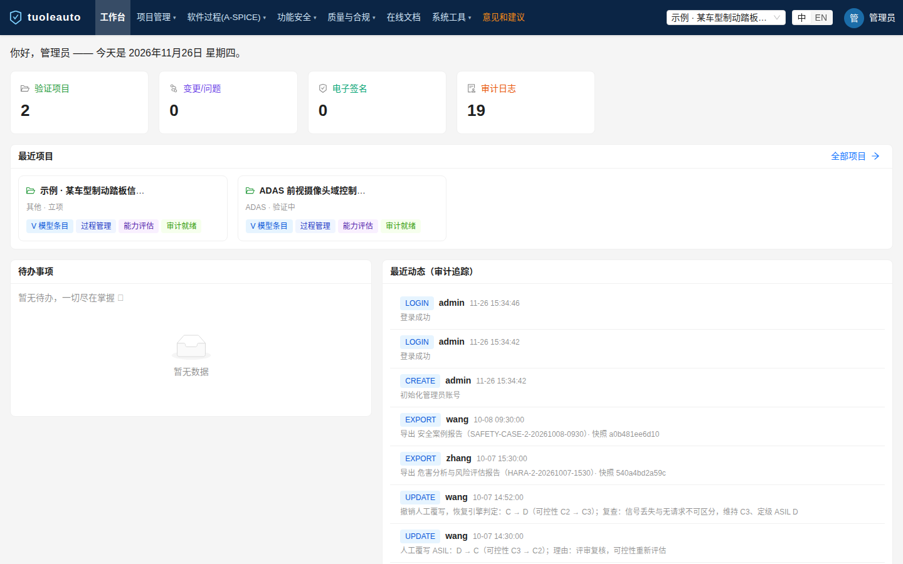
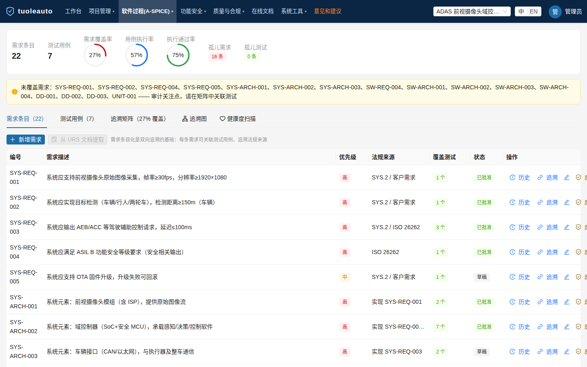
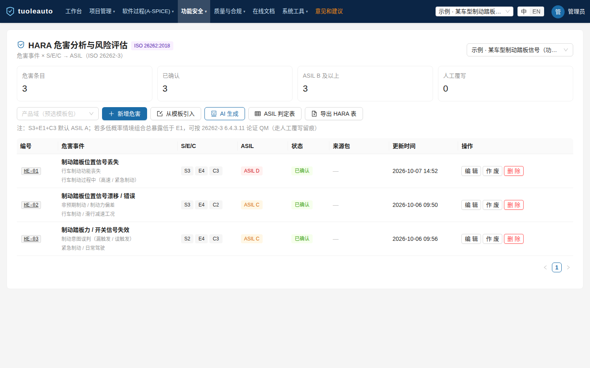
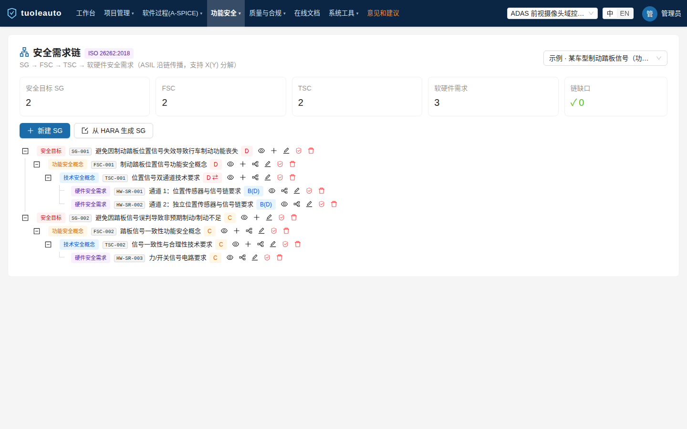

<a name="zh"></a>
# tuoleX auto · 社区版

**简体中文** ｜ [English](#english)

> 汽车软件过程与证据管理工具，自托管、可审计、无遥测。

## 这是什么

把 A-SPICE 的过程、工作产品、追溯、评审与电子签名、变更记录，放进一个能自己部署的系统里。
适合想先在团队内部跑通「过程 + 证据」、又不想把数据交给第三方的团队。

**社区版包含**：本地账号、项目与成员、A-SPICE 过程树与工作产品、需求/追溯矩阵、评审与电子签名、
哈希链审计追踪、变更/问题（质量体系）、FMEA，以及**功能安全域**（HARA、安全需求链 SG/FSC/TSC、
FMEDA 硬件度量、FTA、DFA、Safety Case、确认措施、安全计划）。导出 CSV/JSON。

**社区版不含**：标准与法规内容库（不含任何标准正文）、AI 智能搭建、家族协同（BOM/3D）、
多租户与试用编排。这些属于商业版，如需了解请联系作者。

## 界面

| 工作台 | 追溯矩阵 |
|---|---|
|  |  |

| 功能安全 · HARA | 安全需求链 |
|---|---|
|  |  |

## 快速开始

```bash
docker compose up -d
# 打开 http://localhost:8087 → 首次会要求创建管理员账号
```

默认端口 8087，可用环境变量改：

```bash
WEB_PORT=9000 JWT_SECRET='换成一个长随机串' docker compose up -d
```

首次启动后，系统会让你创建**本机管理员**（没有出厂默认密码）。账号只存在于你自己的数据库里。

### 数据

PostgreSQL 16，数据卷 `pgdata`。备份：

```bash
docker compose exec db pg_dump -U tuolex tuolex_auto > backup.sql
```

## 配置

| 变量 | 默认 | 说明 |
|---|---|---|
| `WEB_PORT` | 8087 | 对外端口 |
| `POSTGRES_PASSWORD` | tuolex | 数据库密码（生产请改） |
| `JWT_SECRET` | 随机（每次启动变化） | 会话签名密钥（生产必须固定，否则重启后登录态失效） |
| `SEED_DEMO` | 1 | 是否灌入一个演示项目 |

完整清单见 [`.env.example`](.env.example)。

## 目录结构

```
src/            前端（React + Vite + Dexie 本地缓存）
src/core/       领域逻辑：过程树、追溯、审计、签名、功能安全（fs/）
src/modules/    页面模块
server/src/     后端（Express + PostgreSQL）：认证、通用数据 API、审计链
server/src/data 过程库与 WP 模板（自写描述，不含标准原文）
deploy/         Dockerfile 与 nginx 配置
docs/           建模说明与功能安全使用指南
```

## 文档

- [A-SPICE 过程模型（本项目如何建模）](docs/aspice-model.md)
- [功能安全模块使用指南](docs/fs-guide.md)
- [变更记录](CHANGELOG.md)

## 设计取舍

- **本地优先**：不依赖任何外部认证服务，断网可用。
- **无遥测**：不回传任何使用数据。
- **审计可验证**：审计日志为哈希链，篡改会在校验时暴露。
- **只读演示**：欢迎用演示数据试；生产请用自己的项目。

## 维护承诺

- **best-effort**：个人维护，不承诺响应时限与排期。
- **季度同步**：社区版按季度吸收一次上游改动，不跟随每个内部 release。
- **不接受定制**：可以提 issue，但不接定制开发；企业需求请邮件联系。
- **范围边界**：不引入标准正文、不做 SaaS、不加遥测。

## 许可

Apache-2.0（见 `LICENSE`）。标准文本不随本仓库分发；文中出现的标准名称归各自发布机构所有。
名称与标识的使用见 [TRADEMARKS.md](TRADEMARKS.md)。

## 贡献与安全

- 贡献流程与代码约定：[CONTRIBUTING.md](CONTRIBUTING.md)
- 漏洞报告（请勿公开提 issue）：[SECURITY.md](SECURITY.md)

## 联系

问题、部署求助、商业版咨询：`jinxxin@live.com`

---

<a name="english"></a>
## English

[简体中文](#zh) ｜ **English**

> Automotive software process and evidence management — self-hosted, auditable, no telemetry.

### What this is

tuoleX auto puts A-SPICE processes, work products, traceability, reviews and electronic signatures,
and change records into a system you can deploy yourself. It is aimed at teams that want to establish
"process + evidence" inside their own environment without handing data to a third party.

**Included in the Community Edition**: local accounts, projects and members, A-SPICE process tree and
work products, requirements/traceability matrix, reviews and electronic signatures, hash-chained audit
trail, change/issue management (quality system), FMEA, and the **functional safety domain** (HARA,
safety requirement chain SG/FSC/TSC, FMEDA hardware metrics, FTA, DFA, safety case, confirmation
measures, safety plan). CSV/JSON export.

**Not included**: standards and regulatory content library (no standards text is bundled), AI-assisted
scaffolding, family collaboration (BOM/3D), multi-tenancy and trial provisioning. These belong to the
commercial edition; please contact the author for details.

### Screenshots

| Workspace | Traceability matrix |
|---|---|
|  |  |

| Functional safety · HARA | Safety requirement chain |
|---|---|
|  |  |

### Quick start

```bash
docker compose up -d
# open http://localhost:8087 → first launch asks you to create an administrator
```

Default port is 8087; override it with environment variables:

```bash
WEB_PORT=9000 JWT_SECRET='a long random string' docker compose up -d
```

On first launch the system asks you to create a **local administrator** (there is no factory default
password). Accounts exist only in your own database.

#### Data

PostgreSQL 16, data volume `pgdata`. Backup:

```bash
docker compose exec db pg_dump -U tuolex tuolex_auto > backup.sql
```

### Configuration

| Variable | Default | Description |
|---|---|---|
| `WEB_PORT` | 8087 | Public HTTP port |
| `POSTGRES_PASSWORD` | tuolex | Database password (change it in production) |
| `JWT_SECRET` | random (changes on every start) | Session signing key (must be fixed in production, otherwise logins are lost on restart) |
| `SEED_DEMO` | 1 | Whether to seed a demo project |

See [`.env.example`](.env.example) for the full list.

### Layout

```
src/            Frontend (React + Vite + Dexie local cache)
src/core/       Domain logic: process tree, traceability, audit, signatures, functional safety (fs/)
src/modules/    Page modules
server/src/     Backend (Express + PostgreSQL): auth, generic data API, audit chain
server/src/data Process library and WP templates (our own descriptions, no standards text)
deploy/         Dockerfile and nginx configuration
docs/           Modeling notes and functional safety guide
```

### Documentation

- [A-SPICE process model (how this project models it)](docs/aspice-model.md)
- [Functional safety module guide](docs/fs-guide.md)
- [Changelog](CHANGELOG.md)

### Design trade-offs

- **Local-first**: no external authentication service; works offline.
- **No telemetry**: no usage data is sent anywhere.
- **Verifiable audit**: the audit log is a hash chain; tampering is exposed when it is verified.
- **Read-only demo**: feel free to explore with the demo data; use your own projects in production.

### Maintenance commitment

- **Best-effort**: maintained by an individual; no response-time or roadmap commitment.
- **Quarterly sync**: the Community Edition absorbs upstream changes once per quarter; it does not
  follow every internal release.
- **No custom development**: issues are welcome, but custom work is not accepted; for enterprise
  needs, contact the author by email.
- **Scope boundaries**: no standards text, no SaaS, no telemetry.

### License

Apache-2.0 (see `LICENSE`). Standards texts are not distributed with this repository; standard names
mentioned here belong to their respective publishers. See [TRADEMARKS.md](TRADEMARKS.md) for name and
mark usage.

### Contributing and security

- Contribution workflow and code conventions: [CONTRIBUTING.md](CONTRIBUTING.md)
- Vulnerability reports (please do not open a public issue): [SECURITY.md](SECURITY.md)

### Contact

Questions, deployment help, commercial edition: `jinxxin@live.com`
